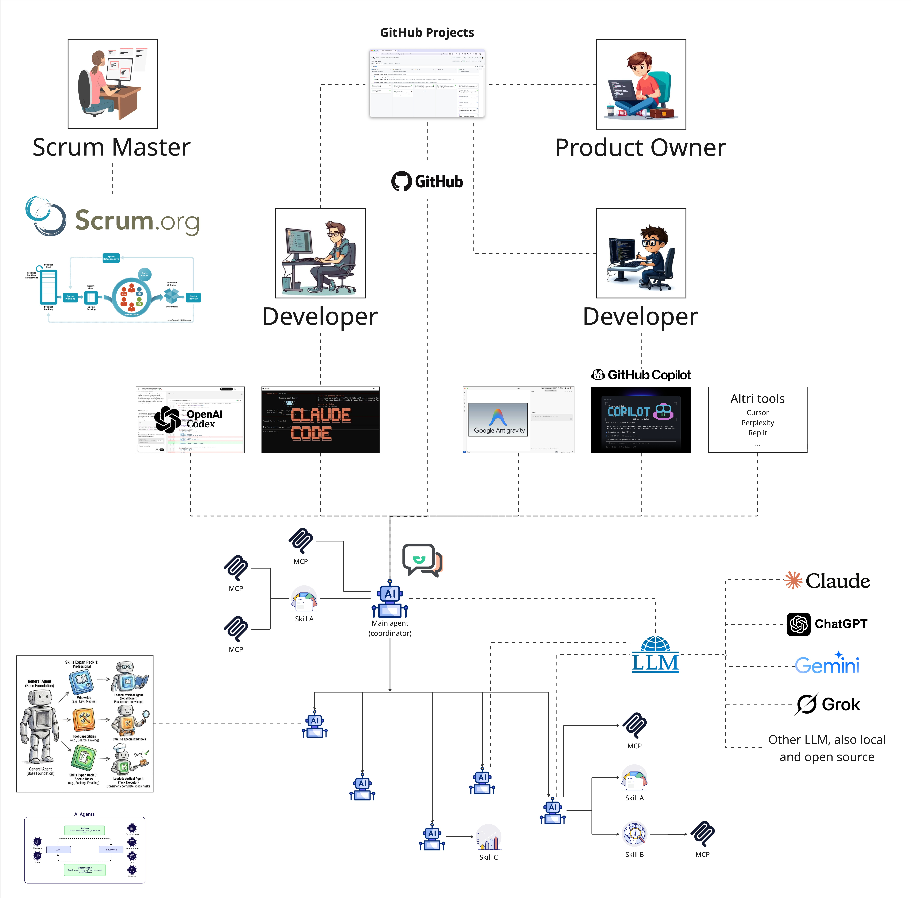

# Vibe Coding — Environment Setup Guide

This guide walks through setting up a working environment for Vibe Coding on this repository (or any repository derived from it). It applies to any AI coding assistant used via CLI (Claude Code, OpenAI Codex, Google Antigravity, OpenCode, GitHub Copilot CLI, Gemini CLI, etc.), with Claude Code + the Superpowers plugin as the reference setup.




How to use the project's knowledge base is in [second-brain.md](second-brain.md). Once set up, try it hands-on with the [tutorial](tutorial/README.md).

---

## Setup checklist

0. [ ] Bootstrap the repository from this template
1. [ ] Install prerequisites (`git`, `gh`, an AI coding CLI)
2. [ ] Install the recommended Superpowers plugin
3. [ ] Install project agents (subagents) into each CLI's agents folder
4. [ ] Install project skills into `.agents/skills/`
5. [ ] Verify MCP servers in `.mcp.json`
6. [ ] Set up the AI instructions file for this repo (`AGENTS.md`)
7. [ ] Verify the setup

---

## 0. Bootstrap the repository

Start a new project from this template:

```bash
git clone https://github.com/frontiere-technologies/vibe.git my-project
cd my-project
rm -rf .git && git init    # optional: start with a fresh history
```

The clone is ready to use: the second brain is empty, `AGENTS.md` has its project sections still to fill in, and no sample code or data is left over. Then adapt what still describes the template rather than your project:

- the root `README.md` — a skeleton for your project's README: fill in its sections
- `LICENSE` — replace it with your project's licence, keeping the SamurAIGPT copyright line and the MIT text (in the same file or a separate one): the `wiki-*` skills and the second brain derive from MIT-licensed work, and the licence's only condition is that this notice stays with every copy (see the provenance note at the end of each skill)
- `sources/` — keep the service-based layout or replace it with your project's folders (see *Layout* in `AGENTS.md`)

Keep the `vibe/` folder: this guide, the [second brain guide](second-brain.md) and the [tutorial](tutorial/README.md) stay with the project. Run the tutorial lessons only on a throwaway branch, never on the branch you build the project on (see the tutorial's README).

### Symlinks on Windows

`.claude/skills` is a symlink to `.agents/skills`. On Windows, Git creates real symlinks only with `core.symlinks=true` and Developer Mode enabled (or administrator rights). Otherwise it checks the symlink out as a small text file containing `../.agents/skills`, and Claude Code does not see the skills.

To fix it, enable Developer Mode, then from Git Bash run:

```bash
git config core.symlinks true
rm .claude/skills && git checkout -- .claude/skills
```

For new clones, `git clone -c core.symlinks=true <url>` creates the symlink directly.

---

## 1. Install prerequisites

- `git` and `gh` (for PRs)
- One AI coding CLI, configured per the table below
- Optional: [`markitdown`](https://github.com/microsoft/markitdown) (`pip install 'markitdown[all]'`), to ingest `.docx`, `.pptx`, `.xlsx` and other binary files into the second brain (see `docs/second-brain/SCHEMA.md`)
- Optional: [`uv`](https://docs.astral.sh/uv/), if the project has Python code (e.g. e2e tests in `sources/tests/e2e/`) — run it through `uv run …` rather than invoking `python`/`pip` directly

| Tool | Config dir | Instructions file | Skills | Agents (subagents) |
|---|---|---|---|---|
| Claude Code | `.claude/` | `CLAUDE.md` (→ `@AGENTS.md`) | `.claude/skills/` (symlink to `.agents/skills/`) | `.claude/agents/<name>.md` (Markdown + YAML frontmatter) |
| OpenAI Codex | `.codex/` | `AGENTS.md` | `.agents/skills/` | `.codex/agents/<name>.toml` (TOML: `name`, `description`, `developer_instructions`) |
| Google Antigravity (`agy`) | `.agents/` | `AGENTS.md` | `.agents/skills/` | check its docs |
| OpenCode | `.opencode/` | `AGENTS.md` | `.agents/skills/` | `.opencode/agents/<name>.md` (Markdown + YAML frontmatter, `mode: subagent`) |
| GitHub Copilot | `.github/` | `AGENTS.md` or `COPILOT-INSTRUCTIONS.md` | own folder — check its docs | own folder — check its docs |
| Gemini CLI | `.gemini/` | `GEMINI.md` (→ `@AGENTS.md`) | own folder — check its docs | own folder — check its docs |

Each tool reads its own instructions file at startup. Keep one canonical file — `AGENTS.md` at the repo root, next to `README.md` — and make every other instructions file a one-line import of it (`CLAUDE.md` and `GEMINI.md` in this repo contain just `@AGENTS.md`), instead of duplicating content.

Keep `AGENTS.md` short: it is loaded on every interaction. Rules needed only for specific work go in files read on demand — in this repo the second-brain rules live in `docs/second-brain/SCHEMA.md` and are read by the `wiki-*` skills.

---

## 2. Install the recommended Superpowers plugin

Install the Superpowers plugin (multi-platform): https://github.com/obra/superpowers

On Claude Code it is enabled per-repo via `.claude/settings.json` (already done in this repo, and copied by step 0):

```json
{
  "enabledPlugins": {
    "superpowers@claude-plugins-official": true
  }
}
```

To enable it on a new repo: `claude plugin install superpowers@claude-plugins-official --scope project`. Other CLIs need their own port of Superpowers, installed separately.

Superpowers provides the workflow this project standardizes on for any non-trivial change (SDD + TDD):

1. `brainstorming` — refine the idea before writing code
2. `using-git-worktrees` — isolate the work on its own branch/worktree
3. `writing-plans` — break the work into small, verifiable tasks
4. `subagent-driven-development` or `executing-plans` — implement task by task
5. `test-driven-development` — red/green/refactor per task
6. `requesting-code-review` — review against the plan before moving on
7. `finishing-a-development-branch` — merge/PR/cleanup

Use this sequence as the default for features and bug fixes; skip steps only for genuinely trivial changes.

---

## 3. Install project agents

Agents (subagents) are specialised assistants the main agent delegates to, each with its own instructions and context. Unlike skills, there is no shared format across CLIs: each tool reads its own folder and format (see the *Agents* column in the table in step 1), so an agent needs one definition per CLI you use.

The reviewers used by the [quality review process](#quality-review-process) are `architect-reviewer`, `code-reviewer` and `ui-ux-tester`. None are installed in this repo yet. Their reference definitions come from the [VoltAgent subagents collection](https://github.com/VoltAgent/awesome-claude-code-subagents/tree/main/categories), written in Claude Code's format, so for Claude Code they can be copied as they are:

```bash
mkdir -p .claude/agents
curl -sL https://raw.githubusercontent.com/VoltAgent/awesome-claude-code-subagents/refs/heads/main/categories/04-quality-security/architect-reviewer.md -o .claude/agents/architect-reviewer.md
curl -sL https://raw.githubusercontent.com/VoltAgent/awesome-claude-code-subagents/refs/heads/main/categories/04-quality-security/code-reviewer.md -o .claude/agents/code-reviewer.md
curl -sL https://raw.githubusercontent.com/VoltAgent/awesome-claude-code-subagents/refs/heads/main/categories/04-quality-security/ui-ux-tester.md -o .claude/agents/ui-ux-tester.md
```

For the other CLIs, convert each definition to the tool's format: keep the name, description and instructions (the Markdown body), and map the frontmatter to the fields that tool expects. An AI coding CLI can do the conversion for you.

Do not install a subagent collection as a whole — copy only the agent definitions actually needed into the repository.

---

## 4. Install project skills

Project skills go in `.agents/skills/<name>/SKILL.md`, the [Agent Skills](https://agentskills.io) folder read by Codex, Antigravity and OpenCode. Claude Code reads the same files through the `.claude/skills` symlink, so each skill is written once.

Installed in this repo:

- `wiki-ingest`, `wiki-query`, `wiki-health`, `wiki-lint` — maintain and query the second brain in `docs/second-brain/`

Recommended:

- `webapp-testing` → https://github.com/anthropics/skills/tree/main/skills/webapp-testing (Playwright-based frontend verification)
- `python-pro` → https://github.com/Jeffallan/claude-skills/tree/main/skills/python-pro (Python 3.11+: type hints, async, pytest, mypy strict, black and ruff)

For Copilot and Gemini CLI, which use their own folders, see the table in step 1.

---

## 5. Verify MCP servers

MCP servers are configured in `.mcp.json` at the repo root. This repo has none yet; create the file when the first one is needed:

```json
{
  "mcpServers": {
  }
}
```

To find more MCP servers: https://registry.modelcontextprotocol.io/ or https://mcpservers.com/. Add new entries under `mcpServers` following the same shape.

GitHub, Supabase, Mail, Calendar, Google Drive and others may be useful for your project.

---

## 6. Setup of the AI instructions file for this repo

`AGENTS.md` at the repo root is the canonical instructions file — every AI coding CLI reads it, either directly or through a one-line import (see step 1). It must include:

- **A pointer to `README.md`** — so the project overview isn't duplicated across instruction files.
- **Layout** — where knowledge (`docs/second-brain/`) and code live (`sources/` for service-based systems, see `sources/README.md`; other folders for other kinds of project).
- **Commands** — how to run dev/build/lint/clean for the app, and how to run the test suite.
- **Stack** — a one-line summary of the tech stack, so the assistant doesn't have to infer it from the manifests.
- **Conventions**, **Testing**, **Boundaries** — the technical constraints: architectural rules, approved libraries, test policy, and what the assistant must not touch.
- **The second brain** — how to use the wiki as knowledge, and where its maintenance rules are.

To start a new repo, copy this repo's `AGENTS.md` to its root and fill in the sections marked *Fill in per project* (the code part of **Layout**, **Commands**, **Stack**, **Conventions**, **Testing**, **Boundaries**). Keep the other sections — *Using the second brain* and *Commit AI-tooling folders to Git* — as they are: they are project-independent conventions, not examples to adapt. Rules that apply to only one part of the code (one service, one app) go in an `AGENTS.md` inside that folder.

---

## 7. Verify the setup

Run these checks from the repository root after the previous steps, and tick the setup checklist as each one passes.

1. **Skills symlink.** `ls .claude/skills/` lists `wiki-health`, `wiki-ingest`, `wiki-lint` and `wiki-query`. If it fails, or shows a file instead of a folder, see *Symlinks on Windows* in step 0.
2. **GitHub CLI.** `gh auth status` reports a logged-in account.
3. **Instructions file.** Start the AI coding CLI and ask: *"Which instructions file did you load, and what are the sections marked Fill in per project?"* The answer must come from `AGENTS.md`, either directly or through `CLAUDE.md`/`GEMINI.md`.
4. **Skills and Superpowers.** Ask: *"Which skills are available?"* The list must include the four `wiki-*` skills and, if installed, the Superpowers skills (`brainstorming`, `writing-plans`, `test-driven-development`, …). In Claude Code, typing `/` shows them as slash commands.
5. **Second brain.** Run `/wiki-health` (in Codex, `$wiki-health`; in any CLI, just `health`). On a new repository it reports an empty wiki with no errors.
6. **Agents** (if installed in step 3). Ask the CLI to list its subagents: `architect-reviewer`, `code-reviewer` and `ui-ux-tester` must appear.
7. **MCP servers** (if configured in step 5). In Claude Code, `claude mcp list` shows each server in `.mcp.json` as connected; other CLIs have an equivalent command.

---

## Quality review process

Run quality reviews using the three agents installed in step 3, saving each to `docs/reviews/<YYYY-MM-DD>-<agent-name>.md`:

- `code-reviewer` agent → `docs/reviews/<YYYY-MM-DD>-code-reviewer.md`
- `architect-reviewer` agent → `docs/reviews/<YYYY-MM-DD>-architect-reviewer.md`
- `ui-ux-tester` agent → `docs/reviews/<YYYY-MM-DD>-ui-ux-tester.md`

Spawn each as a subagent rather than running the review inline.

---

## Resources

- Superpowers plugin: https://github.com/obra/superpowers
- VoltAgent subagents marketplace: https://github.com/VoltAgent/awesome-claude-code-subagents/tree/main/categories (copy individual agents only, don't install as a whole)
- Awesome Claude (menu/extensions): https://awesomeclaude.ai
- Anthropic official skills: https://github.com/anthropics/skills
- Agent Skills standard: https://agentskills.io
- MCP server registries: https://registry.modelcontextprotocol.io/, https://mcpservers.com/

## To be evaluated

- claude-plugins-official: frontend-design, code-review, code-simplifier
- https://github.com/thedotmack/claude-mem
- https://context7.com/ - Get the latest docs into Claude, Codex, Cursor, and other agents
